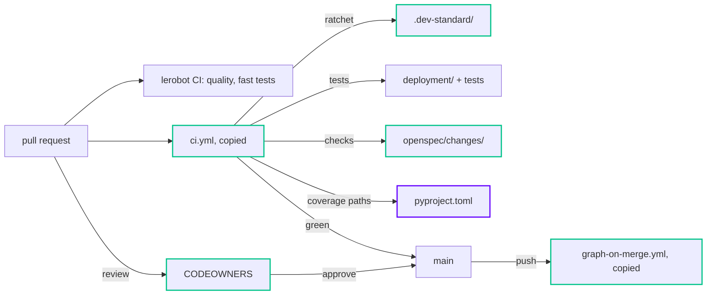
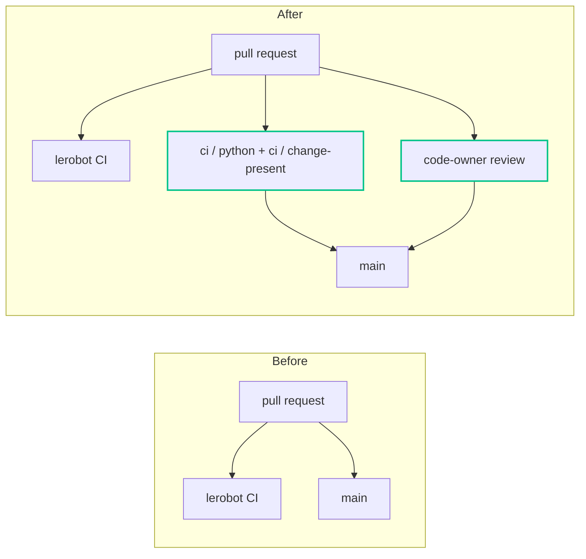

# Design

## Context

See `proposal.md` for why. What shapes the approach:

- lerobot-edge is a public GitHub fork of huggingface/lerobot. The team's own code is `deployment/` (the pi0.5 server)
  and `tests/deployment/`; everything else is upstream, which the standard treats as restricted on a fork.
- `install.sh` (dev-standard v1.3.1) vendors the team configs into `.dev-standard/` and ships workflow stubs that call
  reusable workflows in tiiuae/dev-standard (`uses: …@v1`). That repository is private, and GitHub lets a public
  repository call reusable workflows only from public repositories, so the stubs fail at startup here. dev-standard
  also has no `v1` ref yet, only `v1.0.0` … `v1.3.1`.
- lerobot's own CI (`quality.yml`, `fast_tests.yml`, …) keeps running on every PR and is not changed here.
- `CLAUDE.md` is a symlink to `AGENTS.md`; Issues are disabled on the repository; `main` has no branch protection yet.

## Diagrams

Caption: a PR now meets the team gate (copied `ci.yml`, a change folder, a code-owner review) next to lerobot's
unchanged CI; the second diagram shows what that adds.

Caption: what a PR into `main` goes through before and after the adoption; lerobot's CI is the same in both.

## Goals / Non-Goals

**Goals:**

- The team CI (ratchet, tests, patch coverage, secret scan, change folder) runs on this public fork today.
- Existing lint debt in `deployment/` is frozen by the ratchet, not fixed: new code must be clean.

**Non-Goals:**

- Cleaning existing lint or type debt in `deployment/` or upstream code.
- Changing upstream code, lerobot's own workflows or lerobot's ruff settings.
- A docs site, branch protection, labels or secrets (GitHub settings, done by a human; `tasks.md` group 3).

## Decisions

The durable ones (copied workflows, owned paths only, team rules through the ratchet) are recorded in
`docs/adr/0001-adopt-dev-standard-in-a-public-fork.md`.

- **Copy the two team workflows into the repository, over the `uses:` stubs.** The stubs cannot start on a public
  repository while tiiuae/dev-standard is private. Alternatives: make dev-standard public (an org decision, and it
  also needs a `v1` ref), make lerobot-edge private (a public fork cannot be made private without leaving the fork
  network), or wait (no CI meanwhile). The copies are dev-standard v1.3.1 with the inputs filled in, the same job
  names (so the check names stay `ci / python` and `ci / change-present`), actions pinned to commit SHAs, per-job
  permissions and `persist-credentials: false` where nothing pushes, as this repository's zizmor policy requires.
  Task 4.5 switches back to the stubs once dev-standard is public.
- **Lint, ratchet and test only `deployment/` and `tests/deployment/`, over `src/`.** On a fork, upstream code is not
  ours to clean; upstream's suite keeps running in `fast_tests.yml` / `full_tests.yml`. `dataset-wizard.py` stays out
  for now (task 2.3).
- **Keep lerobot's ruff settings and apply the team rules through the ratchet only, over extending the team base in
  `pyproject.toml`.** With `extend`, pre-commit applies the team rules to every file, so lerobot's Quality check fails
  on upstream code (10,086 findings). A team-rules config scoped to `deployment/` would also fail Quality, on the 88
  existing team-rule findings there (7 of them over the size limits). The ratchet in `ci.yml` lints `deployment/`
  with `.dev-standard/ruff.toml` directly, so new code is still held to the team rules; editors and pre-commit show
  lerobot's rules.
- **`mdx` in `.editorconfig`'s 2-space group, over the installer's default.** Prettier reads `.editorconfig`; with
  4 spaces it re-indents lerobot's `.mdx` docs and fails Quality.
- **The bandit and mypy hooks skip `.dev-standard/`, over fixing the vendored files.** `install.sh` overwrites them on
  every run.
- **Two code owners, over one.** An author cannot approve their own PR, so a single owner could never satisfy
  "Require review from Code Owners" on their own changes.
- **Remove the installer's `@AGENTS.md` line, over keeping it.** It was written through the `CLAUDE.md` symlink and made
  `AGENTS.md` import itself; it comes back on every installer run (task 4.1).

## Risks / Trade-offs

- [The copied workflows drift from dev-standard's] → the header of each file names the source commit; re-copy on every
  dev-standard upgrade, and switch back to the stubs once dev-standard is public (task 4.5).
- [Pinned action SHAs go stale] → bump them deliberately on upgrade, like the rest of this repository's workflows.
- [Editors and pre-commit don't show the team rules] → the ratchet in `ci.yml` blocks new team-rule violations on
  every PR.
- [An installer re-run adds the ruff `extend` back to `pyproject.toml`] → remove it again after every run (task 4.7).
- [The vendored ratchet lets a PR that adds a new owned path through unchecked] → fixed upstream in
  tiiuae/dev-standard#6; arrives with the next dev-standard upgrade.

## Migration Plan

Merge this PR, then a human turns on branch protection for `main` with the checks `ci / python` and
`ci / change-present` and a code-owner review (task 3.1). Rollback: revert the squash commit; nothing outside the
repository changes.
