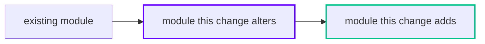

# Design

## Context

<!-- Current state and constraints that shape the approach. See proposal.md for motivation - don't restate it -->

## Diagrams

<!-- Mermaid, rendered by GitHub here and in the PR body. Always a flowchart of what this change touches; add a
     sequenceDiagram for an interaction over time, a stateDiagram-v2 for new or changed states, a Before/After pair
     when behavior changes. Real module/service/device names, about 15 nodes at most, one caption line under each. -->

<!-- Caption: what to look at in this diagram -->

## Goals / Non-Goals

**Goals:**

<!-- What this design aims to achieve -->

**Non-Goals:**

<!-- What is explicitly out of scope -->

## Decisions

<!-- Key design decisions with rationale and alternatives considered -->

## Risks / Trade-offs

<!-- Known risks and trade-offs -->
